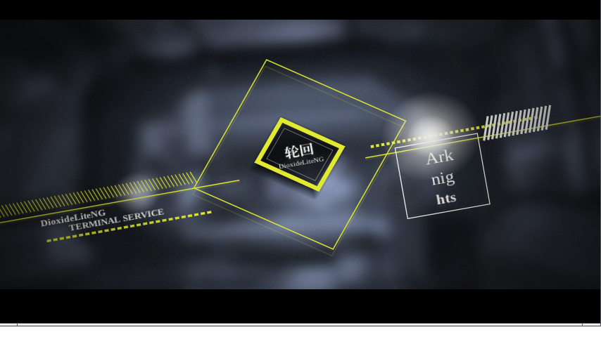
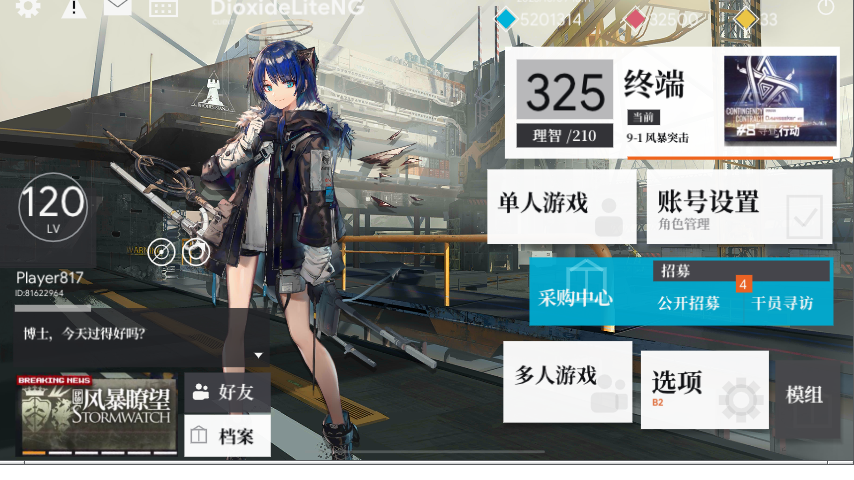
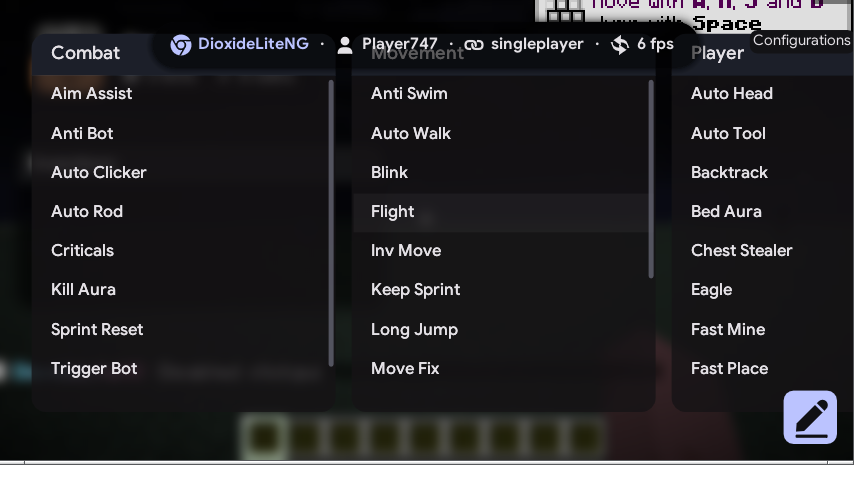
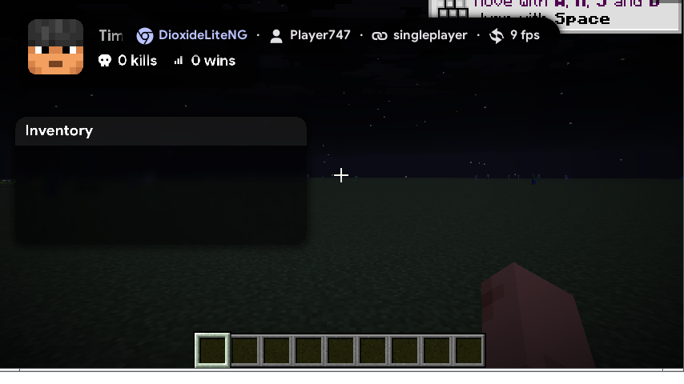

# DioxideLite

<div align="center">
    
</div>

**DioxideLite** 是一个基于 Mixin 运行时注入的开源 Minecraft 客户端（Fabric），为 Minecraft **26.3** 打造：保留流畅的 HUD 视觉、ClickGUI 与启动体验，并在 B7 之后整包移植了 [Krs](https://github.com/Aspw-w/Krs) 的绕过类模块，形成完整的战斗 / 移动 / 世界 / 杂项能力。

> 当前版本：**B10** · 平台：Fabric · 游戏版本：Minecraft 26.3 · Java 25 · 支持 Windows / Linux / macOS

---

## 版本沿革

| 版本 | 定位 |
| --- | --- |
| B2 | 视觉改版：启动动画、主菜单干员主题、ClickGUI / HUD 视觉调整 |
| B3 | 主菜单立绘更换为「维什戴尔 · 绝对主角」 |
| B7 | 以 B3 为基座重建，整包移植 Krs 非可视化模块（102 个）+ 9 个新事件与全部分发点 |
| B8 | 修复 B7 运行期缺陷：MovementFix routine 接线、Scaffold2 疾跑、WTap / MaceExploit 攻击钩子 |
| B9 | 打滑模块全面对照 Krs 审计：Scaffold2 数学放置评分还原、RotationManager 摆动条件精确化 |
| **B10** | 修复 B9 审计遗留的三处偏差；移植 Krs `Rotations` 渲染模块，补全第三人称转头渲染 |

## 特性

- **启动动画**：自定义 LaunchIntro 四阶段启动动画（boot → login → connection → emblem），「轮回」品牌标识 + TERMINAL SERVICE 登录窗，约 13 秒。
- **主菜单（干员主题）**：「风暴瞭望 STORMWATCH」活动入口、干员立绘、终端数值面板（理智 / 等级 / 关卡进度 / 日期横幅）。
- **渐变品牌消息前缀**：聊天每字符按色相渐变渲染。
- **ClickGUI**：多主题布局，左键开关模块、右键展开设置，GUI Scale 可调。
- **HUD 编辑器**：ClickGUI 右下角铅笔按钮进入，自由拖拽排版（RESET / DONE）。
- **DynamicIsland 灵动岛**：顶部胶囊信息面板，实时显示客户端版本 / FPS / 延迟 / 模块开关提示。
- **账户管理**：微软登录（内嵌 WebView）、Altening 会话、账户保存与切换。
- **静默转头（silent aim）**：`RotationManager` 三态（client / server / render）旋转引擎，配合 `PacketUtil` 的 silent 发包通道，转头值与发包值分离。
- **Rotations 渲染模块**：第三人称模型按欺骗朝向渲染，可选 vanilla 提取路径或直接覆写渲染状态。
- **模块体系（151 个）**：
  - **Combat（25）**：KillAura / KillAura2、AimAssist、AutoClicker、Auto Rod、Auto Totem、Auto Pot、Criticals / Criticals2、TriggerBot、Reach、Velocity / Velocity2、AntiBot / AntiBot2、Backtrack2、WTap、Mace Exploit、Crossbow Exploit、Fast Bow、Fast Eat、No Combat Delay、SprintReset、Target Strafe、Teams
  - **Movement（41）**：Fly2、Speed2、Blink / Blink2、LongJump2、Stasis2、Step、Jesus2、Spider2、NoSlow2、Parkour2、SafeWalk2、NoWeb2、Movement Fix、MovementCorrection、Sprint2、KeepSprint、InventoryMove2、Anti Void、FastFall2、Timer 等
  - **Player（36）**：Scaffold2、ChestStealer2、InvManager2、NoFall2、AutoTool2、FastBreak2、FastPlace、Freecam、Phase、SpinBot2、AirPlace2、Auto Respawn2、Auto Leave2、HackerDetector2、MurdererDetector2、ChatCommands、PathFinder 等
  - **Visual（14）**：ClickGui、HUD、NameTags、PlayerEsp、Scoreboard、Ambience、Animations、AntiFire、BedPlates、Cape、FullBright、NoHurtCamera、Theme、Rotations
  - **Misc（35）**：Disabler2、XCarry、Xray、Nuker、Civ Break、Breaker、Note Bot、TP Stealer、TP Surround、Packet Duper、Portal God Mode、Timer2、Transaction Confirm Blinker、Spammer、Whitelist、WindCharge 等
- **工程与安全**：分布式事件总线（EventBus）、模块生命周期管理（FeatureManager）、原子化配置持久化（AtomicFiles / ClientStateStore）、`.config save/load` 预设、**63 个 Mixin** 覆盖渲染 / 输入 / 网络 / 菜单多个切面。

## 截图

| 启动动画 | 主菜单 |
| --- | --- |
|  |  |

| ClickGUI | HUD 游戏界面 |
| --- | --- |
|  |  |

## 使用方式

1. 按 `./gradlew build` 构建得到 `build/libs/dioxideliteng-b10.jar`。
2. 为 Minecraft 26.3 安装 Fabric Loader 0.19.5+。
3. 将 jar 放入 `mods` 目录，用 Java 25 启动 Fabric 档位。
4. **Right Shift** 打开 ClickGUI；聊天输入 `.help` 查看指令；`.config save/load <name>` 管理预设。
5. 自动状态存于 `dioxideliteng/state.json`，预设存于 `dioxideliteng/configs/`（游戏目录下）。

## 构建

使用 JDK 25（Temurin 25.0.4.1 LTS）：

```bash
./gradlew clean build
```

产物位于 `build/libs/`：

- `dioxideliteng-b10.jar`（含内嵌依赖与各平台 JavaFX / LWJGL native）
- `dioxideliteng-b10-sources.jar`

## 源码规模

| 项目 | 数量 |
| --- | --- |
| Java 源文件 | 433 |
| 功能模块 | 151 |
| Mixin | 63 |

## 更新日志

| 版本 | Devlog |
| --- | --- |
| B10 | [devlog-b10.md](devlog-b10.md) — 修复 no order 摆动包 / hypixel ncp 门控 / Blink2 Freecam 门控；移植 Krs `Rotations` 渲染模块 |
| B9 | [devlog-b9.md](devlog-b9.md) — 打滑模块全面对照 Krs 审计，Scaffold2 数学放置评分还原，RotationManager 摆动条件精确化 |
| B8 | [devlog-b8.md](devlog-b8.md) — 接线 Krs MovementFix routine，修复 Scaffold2 疾跑与 WTap / MaceExploit 攻击钩子 |
| B7 | [devlog-b7.md](devlog-b7.md) — 以 B3 为基座全量移植 Krs 非可视化模块（102 个功能模块 + 9 事件分发层 + 35 个 utils） |
| B3 | [devlog-b3.md](devlog-b3.md) — 主菜单立绘更换为「维什戴尔 · 绝对主角」 |
| B2 | [devlog-b2.md](devlog-b2.md) — 视觉改版：启动动画与主菜单视觉升级 + ClickGUI / HUD 视觉调整 + 全平台构建验证 |

详细更新记录见 [CHANGELOG.md](CHANGELOG.md)。

## 致谢

绕过逻辑参考并移植自 [Krs](https://github.com/Aspw-w/Krs)（作者 Aspw-w），按模块逐一对照实现，仅做 API 与事件系统适配。

## 许可

本项目基于 **GPL-3.0-or-later** 开源（详见 [LICENSE](LICENSE)）。

## 联系

QQ：**81622964**
